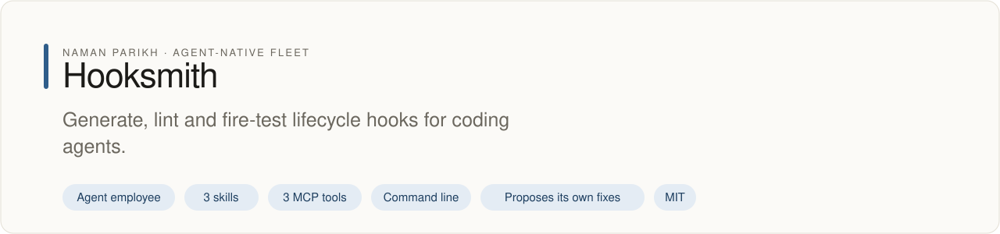
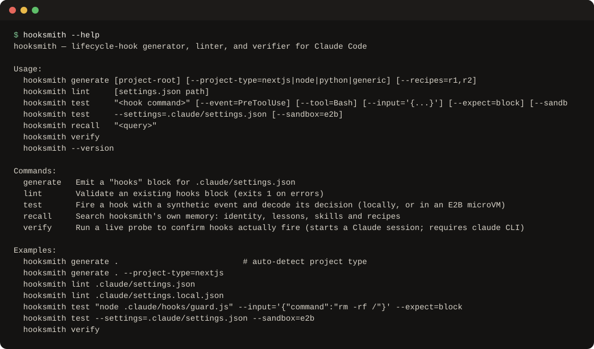

# hooksmith

<!-- fleet:header:start -->
<p align="center"><picture><source media="(prefers-color-scheme: dark)" srcset="assets/banner-dark.svg"></picture></p>

<p align="center">
<a href="https://github.com/naman10parikh/hooksmith/actions/workflows/ci.yml"></a>
<a href="https://github.com/naman10parikh/hooksmith/releases"></a>
<a href="LICENSE"></a>
<a href="#use-it-from-any-coding-agent"></a>
<a href="https://x.com/naman10parikh"></a>
<a href="https://www.linkedin.com/in/naman-parikh1/"></a>
</p>

<p align="center"><a href="#quick-start">Quick start</a> · <a href="https://naman10parikh.github.io/hooksmith/">Website</a> · <a href="docs/README.md">How it works</a> · <a href="AGENTS.md">AGENTS.md</a> · <a href="llms.txt">llms.txt</a> · <a href="skills/">Skills</a> · <a href="https://github.com/naman10parikh/hooksmith/discussions">Discussions</a> · <a href="https://github.com/naman10parikh">All projects</a></p>

**Generate, lint and fire-test lifecycle hooks for coding agents.**

Hooksmith is an agent employee, a packaged specialist agent with its own skills, memory and tests. It owns one job: hooks. Coding agents use it through its skills, its MCP server and its command line. A scheduled job runs its evals and proposes fixes. A person makes every change.

_Hooksmith is part of an agent-native play for agent-native systems that can eventually be recursively self-improving and evolving, operated by agent employees._

<p align="center"></p>
<!-- fleet:header:end -->

Hooksmith owns the `hooks` key inside Claude Code's `.claude/settings.json`. It generates that block for a project
by type, lints an existing one against the 33 hook events and 5 handler types Claude Code has today, and fire-tests
each hook with the event Claude Code would send, so you see whether a guard really blocks. It is for anyone who
writes hooks for a coding agent, or runs hook scripts they did not write: those can run inside an E2B microVM.

<!-- fleet:use:start -->
## Use it from any coding agent

**Claude Code**: the plugin brings the skills, sub-agents, hooks and MCP server.

```
/plugin marketplace add naman10parikh/hooksmith
/plugin install hooksmith@hooksmith
```

<details><summary>Its MCP server, Codex, Cursor, Gemini CLI, one skill and the command line</summary>

**Its MCP server**, in any MCP client:

```bash
claude mcp add --transport stdio hooksmith -- npx -y -p github:naman10parikh/hooksmith hooksmith-mcp
codex mcp add hooksmith -- npx -y -p github:naman10parikh/hooksmith hooksmith-mcp
```

Cursor (`.cursor/mcp.json`), Gemini CLI (`.gemini/settings.json`) and most other clients take the same command as JSON:

```json
{
  "mcpServers": {
    "hooksmith": {
      "command": "npx",
      "args": [
        "-y",
        "-p",
        "github:naman10parikh/hooksmith",
        "hooksmith-mcp"
      ]
    }
  }
}
```

**Gemini CLI**: the extension brings the context and the MCP server.

```bash
gemini extensions install https://github.com/naman10parikh/hooksmith
```

**One skill** (3 in all, in [skills/](skills/)), in any agent that reads Agent Skills:

```bash
gemini skills install https://github.com/naman10parikh/hooksmith --path skills/hook-generate
git clone --depth 1 https://github.com/naman10parikh/hooksmith /tmp/hooksmith && cp -r /tmp/hooksmith/skills/hook-generate ~/.claude/skills/
```

**The command line:**

```bash
npx -y -p github:naman10parikh/hooksmith hooksmith --help
```

</details>

Codex, Cursor, OpenCode, GitHub Copilot and other agents read [AGENTS.md](AGENTS.md); Claude Code reads [CLAUDE.md](CLAUDE.md) and Gemini CLI reads [GEMINI.md](GEMINI.md), which import it. [llms.txt](llms.txt) maps every surface for agents that read first.
<!-- fleet:use:end -->

## Quick start

It installs from GitHub; nothing is published to npm.

```bash
git clone https://github.com/naman10parikh/hooksmith && cd hooksmith
pnpm install && pnpm build
pnpm test && pnpm eval                                   # unit tests, then the golden tasks

node dist/src/cli.js generate . --project-type=node      # a hooks block on stdout
node dist/src/cli.js lint .claude/settings.json          # ✓ hooks block: 0 violations
node dist/src/cli.js test "echo no >&2; exit 2" --expect=block
# fire-test: decision=block exit=2 (29 ms, local)
node dist/src/cli.js test --settings=.claude/settings.json   # fires hooksmith's own 4 hooks once
node dist/src/cli.js recall "timeout seconds"            # searches its memory and lessons
```

With `E2B_API_KEY` set, add `--sandbox=e2b` to run the hook in a fresh microVM instead of on your machine:

```bash
node dist/src/cli.js test "echo no >&2; exit 2" --expect=block --sandbox=e2b
# fire-test: decision=block exit=2 (691 ms, e2b, cold start 296 ms)
```

## How it works

| Command              | What it does                                                                  |
|----------------------|-------------------------------------------------------------------------------|
| `hooksmith generate` | Emit a `hooks` block for a project (auto-detects nextjs, node, python, generic) |
| `hooksmith lint`     | Validate an existing `settings.json` hooks block and report each problem       |
| `hooksmith test`     | Fire one hook, or every hook in a settings file, and decode its decision        |
| `hooksmith recall`   | Search hooksmith's own memory: identity, lessons, skills and recipes            |
| `hooksmith verify`   | Start a real Claude session to confirm PreToolUse and PostToolUse fire          |

**Fire-testing.** `hooksmith test` sends the hook the JSON a real event carries (`hook_event_name`, `tool_name`,
`tool_input`, `cwd`) on stdin, sets `CLAUDE_PROJECT_DIR`, and reads the result the way Claude Code does: exit code 2
blocks; a `permissionDecision` of allow, deny, ask or defer in the output decides; `"decision": "block"` or
`"continue": false` blocks; anything else passes. With `--sandbox=e2b`, the files the command names are uploaded to
a new E2B Firecracker VM, the hook runs there, and the VM is killed. No Claude session is started, so it costs nothing
to run on every change; `verify` is the slower end-to-end check.

**Its own hooks.** In this repository, `hooks/settings-guard.mjs` runs after every Write or Edit. When an agent
edits a hooks file and breaks it, the guard reports the errors back at once (the plugin ships the same hook).

### Recipe catalog

10 named recipes covering the full Claude Code lifecycle:

| Recipe ID          | Event       | What it does                                   |
|--------------------|-------------|------------------------------------------------|
| session-start      | SessionStart| Inject context + apply budget tier             |
| compact-restore    | SessionStart| Re-inject anchor-state after compaction        |
| pre-tool-block     | PreToolUse  | Block dangerous Bash commands                  |
| post-write-format  | PostToolUse | Auto-format with prettier after writes         |
| post-push-verify   | PostToolUse | Verify deploy after git push                   |
| audit-log          | PostToolUse | Log every tool call to audit trail             |
| pre-compact-flush  | PreCompact  | Flush context to disk before compaction        |
| task-gate          | Stop        | Block exit if tasks still in_progress          |
| rate-limit-recover | StopFailure | Handle rate limits gracefully                  |
| session-end-log    | SessionEnd  | Write session summary to daily log             |

### Linter violations

| Code                    | Severity | Description                                                        |
|-------------------------|----------|--------------------------------------------------------------------|
| UNKNOWN_EVENT           | error    | Event name not one of the 33 Claude Code fires (typo?)             |
| MISSING_HOOKS_ARRAY     | error    | HookMatcher missing `hooks` key                                    |
| EMPTY_HOOKS_ARRAY       | warning  | Hooks array is empty (matcher does nothing)                        |
| INVALID_HOOK_TYPE       | error    | Type is not `command`, `http`, `mcp_tool`, `prompt` or `agent`     |
| MISSING_FIELD           | error    | `http` needs `url`; `prompt` and `agent` need `prompt`; `mcp_tool` needs `server` and `tool` |
| MISSING_COMMAND         | error    | A command hook has no command string                               |
| MISSING_TIMEOUT         | warning  | PreToolUse Bash hook missing timeout (will hang)                   |
| TIMEOUT_IN_MILLISECONDS | warning  | Timeout above 600: Claude Code reads seconds, so 3000 is 50 minutes |
| SCRIPT_NOT_FOUND        | error    | Script path doesn't exist on disk                                  |
| SCRIPT_NOT_EXECUTABLE   | error    | Script exists but isn't executable (chmod +x)                      |

### Architecture

```
src/
  generator.ts   # generateHooksBlock(opts) → HooksBlock
  linter.ts      # lintHooksBlock(block) → LintResult; VALID_EVENTS
  fire-test.ts   # fireTest(input) → decision, locally or in E2B
  verify.ts      # verifyHooksFire() → VerifyResult
  recall.ts      # recall(query) → sections of its own memory
  run-log.ts     # one JSON line per run in logs/run-log.jsonl
  cli.ts         # CLI glue: generate | lint | test | recall | verify
  mcp-server.ts  # hooksmith-mcp: hook_generate | hook_lint | hook_test

catalog/recipes.json   # machine-readable recipe registry
evals/eval.ts          # golden tasks (vitest), run on every pull request
scripts/event-drift.mjs   # nightly: the linter's events vs Claude Code's published schema
```

Every night `.github/workflows/improve.yml` builds, runs the evals, fires hooksmith's own hooks and compares the
events the linter knows with Claude Code's published settings schema. If Claude Code has gained an event, it opens an
issue with the change to make; a person reviews and merges it.

<!-- fleet:anatomy:start -->
## What it is made of

Every project in this fleet is graded on the same 11 harness components and on self-improvement. Each mark is backed by a file you can open.

| Component | Grade | Where |
| --- | --- | --- |
| Identity | ✅ | identity/SOUL.md:3 |
| Memory | ✅ | identity/LEARNINGS.md:1 · src/recall.ts:71 (recall) |
| Skills | ✅ | skills/ (3 own skills) |
| Tools/CLIs | ✅ | package.json:10 (hooksmith, hooksmith-mcp) |
| Hooks | ✅ | .claude/settings.json:9 · hooks/settings-guard.mjs:1 |
| Sub-agents | ✅ | .claude/agents/hook-reviewer.md:2 · hook-fire-tester.md:2 |
| MCPs | ✅ | src/mcp-server.ts:98 (3 tools) |
| Dispatch | ✅ | .github/workflows/improve.yml:7 (nightly) |
| Evals | ✅ | evals/eval.ts:316 · .github/workflows/ci.yml:21 |
| Observability | ✅ | src/run-log.ts:47 (run log) |
| Sandbox/Infra | ✅ | src/fire-test.ts:161 (E2B microVM) |
| Self-improvement | ✅ | dsip.json:2 · scripts/event-drift.mjs:1 (honest L2) |

✅ real and tested · 🟡 partial, with the reason in the row · ❌ absent
<!-- fleet:anatomy:end -->

<!-- fleet:footer:start -->
## How it improves itself

It carries its own evals and a self-improvement contract, [`dsip.json`](dsip.json), which says what it may change and how a change is judged. A scheduled job runs its evals and proposes fixes. A person makes every change. Lessons it learns are kept as rules in its memory files.

## Part of a fleet

One of the projects by [Naman Parikh](https://github.com/naman10parikh). Each owns one part of an agent's harness, or of the product around an agent, and all of them follow one standard.

| Related project | What it owns |
| --- | --- |
| [AgentDial](https://github.com/naman10parikh/agentdial) | Identity |
| [WikiMem](https://github.com/naman10parikh/wikimem) | Memory |
| [Skillsmith](https://github.com/naman10parikh/skillsmith) | Skills |
| [Agent Booster](https://github.com/naman10parikh/agent-booster) | Tools / CLIs |
| [AgentCast](https://github.com/naman10parikh/agentcast) | Sub-agents |
| [Plugsmith](https://github.com/naman10parikh/plugsmith) | Plugins |
| [Armory](https://github.com/naman10parikh/armory) | MCPs and the component registry |
| [AgentGrid](https://github.com/naman10parikh/agentgrid) | Dispatch |
| [AgentSwarm](https://github.com/naman10parikh/agentswarm) | Dispatch |
| [AgentBench](https://github.com/naman10parikh/agentbench) | Evals |
| [AgentMoney](https://github.com/naman10parikh/agentmoney) | Observability |
| [Sandforge](https://github.com/naman10parikh/sandforge) | Sandbox / Infra |
| [Claude Harness](https://github.com/naman10parikh/claude-harness) | The whole harness, as a template |

## Community

Questions and ideas go to [Discussions](https://github.com/naman10parikh/hooksmith/discussions); bugs go to [issues](https://github.com/naman10parikh/hooksmith/issues/new/choose). Follow the work on [X](https://x.com/naman10parikh) and [LinkedIn](https://www.linkedin.com/in/naman-parikh1/).

## Contributing and security

Read [CONTRIBUTING.md](CONTRIBUTING.md). AI-assisted pull requests are welcome. Report a vulnerability privately, as [SECURITY.md](SECURITY.md) explains.

## License

MIT, © 2026 Naman Parikh. See [LICENSE](LICENSE) and [NOTICE](NOTICE).

## Star history

If it is useful to you, a star helps other people find it.

<a href="https://star-history.com/#naman10parikh/hooksmith&Date"><picture><source media="(prefers-color-scheme: dark)" srcset="https://api.star-history.com/svg?repos=naman10parikh/hooksmith&type=Date&theme=dark"></picture></a>

## Contributors

<a href="https://github.com/naman10parikh/hooksmith/graphs/contributors"></a>
<!-- fleet:footer:end -->
