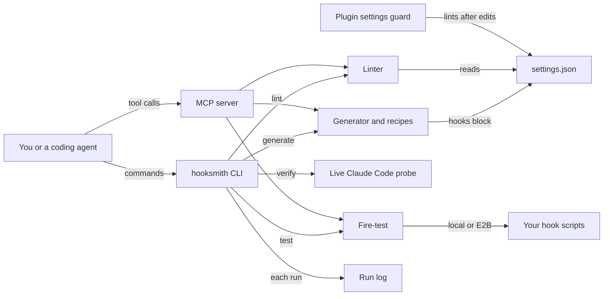

# How Hooksmith works

Hooksmith generates, lints and fire-tests lifecycle hooks for coding agents.
A hook is a command that Claude Code runs at a lifecycle event, such as before a tool call or when a session starts.
Hooks are declared in the `hooks` block of `.claude/settings.json`.
Hooksmith writes that block for your project type, checks an existing block for mistakes, and runs a hook to show what it decides.
It is for people and coding agents who set up hooks and want proof that they work.

## The parts

The CLI is [src/cli.ts](../src/cli.ts).
[src/generator.ts](../src/generator.ts) builds a hooks block from ten recipes and picks defaults by project type.
[catalog/recipes.json](../catalog/recipes.json) describes each recipe: its event, matcher, scripts and the project types it suits.
[src/linter.ts](../src/linter.ts) checks an existing block against the 33 hook events and five handler types it knows.

[src/fire-test.ts](../src/fire-test.ts) runs one hook with a made-up event on standard input and decodes its decision.
It runs on your machine, or inside an E2B sandbox, a short-lived virtual machine, for scripts you do not trust.
[src/verify.ts](../src/verify.ts) starts a real `claude -p` session in a temporary folder to prove that PreToolUse and PostToolUse hooks fire.
[src/mcp-server.ts](../src/mcp-server.ts) offers `hook_generate`, `hook_lint` and `hook_test` over MCP, the Model Context Protocol that agents use to call tools.
The plugin hook [hooks/settings-guard.mjs](../hooks/settings-guard.mjs) lints a settings file right after an agent edits it.
[src/run-log.ts](../src/run-log.ts) appends a line for each generate, lint and fire-test run to `logs/run-log.jsonl`.
[src/recall.ts](../src/recall.ts) searches Hooksmith's own notes, skills and recipes for `hooksmith recall`.

## What happens when you run it

The main flow is `hooksmith generate .`, then `hooksmith lint`, then `hooksmith test`.

1. `generate` calls `detectProjectType` in [src/generator.ts](../src/generator.ts). A `next.config` file means nextjs and a `package.json` means node. A `pyproject.toml`, `requirements.txt` or `setup.py` means python. Anything else is generic.
2. `generateHooksBlock` takes that type's default recipes, unless `--recipes` names others. Each recipe belongs to one event. For example, `pre-tool-block` belongs to PreToolUse.
3. It merges recipes that share an event and matcher, then prints the block as JSON. You merge it into `.claude/settings.json` yourself. Its script paths point at `.claude/hooks/` in your project.
4. `lint` runs `lintHooksBlock` in [src/linter.ts](../src/linter.ts). It flags unknown events, unknown handler types and missing handler fields. It also flags missing or non-executable scripts, empty matchers, a PreToolUse Bash hook without a timeout, and timeouts that look like milliseconds. It exits with code 1 on any error.
5. `test "<hook command>"` builds the JSON event Claude Code would send, in [src/fire-test.ts](../src/fire-test.ts). It runs the command with that JSON on standard input, locally or with `--sandbox=e2b`.
6. It decodes the decision. Exit code 2 means block. A JSON reply with a permission decision means allow, deny, ask or defer. Anything else is a pass. With `--expect=block`, any other decision fails the run.
7. Each of these runs appends a line to `logs/run-log.jsonl` through [src/run-log.ts](../src/run-log.ts).

## Extending it

- **A new recipe.** In [src/generator.ts](../src/generator.ts), add its id to `RecipeId`, its matchers to `buildRecipes` and its event to `RECIPE_EVENT`. Add it to `DEFAULT_RECIPES` if a project type should get it by default. Describe it in [catalog/recipes.json](../catalog/recipes.json) and add a case to [evals/eval.ts](../evals/eval.ts).
- **A new hook event.** Add it to `VALID_EVENTS` in [src/linter.ts](../src/linter.ts) and to the fallback list in [hooks/settings-guard.mjs](../hooks/settings-guard.mjs). [tests/settings-guard.test.ts](../tests/settings-guard.test.ts) keeps the two lists equal. Add one eval case per event.
- **A new lint rule.** Add a check with a severity and a code to `lintHooksBlock` in [src/linter.ts](../src/linter.ts), then add an eval case.
- **A new MCP tool.** Add it to `TOOLS` and to `dispatch` in [src/mcp-server.ts](../src/mcp-server.ts). A tool that waits on slow work, like `hook_test`, is answered in the line reader at the bottom of that file. Add a call to [scripts/mcp-smoke.mjs](../scripts/mcp-smoke.mjs).
- **A new skill.** Add `skills/<name>/SKILL.md` beside the three in [skills/](../skills/).

Then run `pnpm build`, `pnpm test`, `pnpm eval` and `node scripts/mcp-smoke.mjs`.

## Questions

**Does it need an API key or cost money?**
Hooksmith is free and MIT licensed.
`generate`, `lint`, local `test`, `recall` and the MCP server call no model and need no key.
`test --sandbox=e2b` needs `E2B_API_KEY` and the optional `e2b` package, and E2B is a paid service.
`verify` starts a real Claude Code session, so it uses your Claude Code account. It is skipped when `claude` is not installed.

**Does any data leave the machine?**
`generate`, `lint` and local tests only read and write files on your machine.
`test --sandbox=e2b` uploads the hook's script files and the test event to an E2B sandbox, then deletes the sandbox.
`verify` sends one short prompt through Claude Code.

**How does it improve itself?**
[dsip.json](../dsip.json) names no level.
It lists the steps review, extract, prioritize, validate and ship, and one outside source: Claude Code's published settings schema.
Every night [.github/workflows/improve.yml](../.github/workflows/improve.yml) builds, runs the evals and fires the repository's own hooks.
Then [scripts/event-drift.mjs](../scripts/event-drift.mjs) compares the linter's events with the events in that schema.
If the schema lists an event the linter lacks, the workflow opens an issue with a proposed change.
A person lands every change.

**How do I run its tests or evals?**
Run `pnpm install` and `pnpm build`.
`pnpm test` runs both [tests/](../tests/) and [evals/eval.ts](../evals/eval.ts).
`pnpm eval` runs only the golden tasks in [evals/eval.ts](../evals/eval.ts).
`node scripts/mcp-smoke.mjs` talks to the built MCP server the way a client would.

**What does it not do?**
It does not write the hook scripts that the generated block points to.
The recipes expect scripts such as `block-dangerous-commands.js` in `.claude/hooks/`, and `lint` reports any that are missing.
It does not merge the block into your settings file for you.
`verify` checks only that PreToolUse and PostToolUse fire, not every event.
